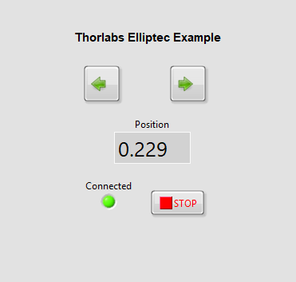
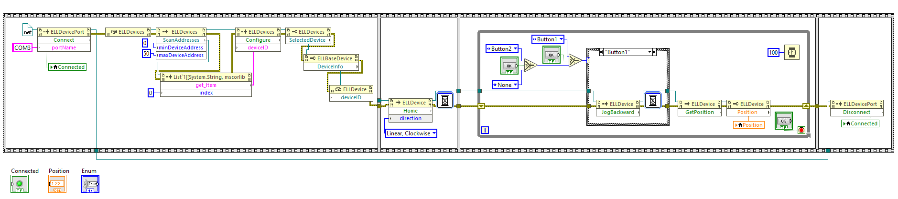

# Simple Example
Shows how to connect to a Thorlabs Elliptec device and perform jog moves.\
It uses the dll Thorlabs.Elliptec.ELLO_DLL.dll which is found in C:\Program Files\Thorlabs\Elliptec\ after installation of the ELLO software from the Thorlabs website.\

Tested with Labview 2025 Q3, 64 Bit\
Saved for Labview 2019, 64 Bit\
ELLO version 1.6.5.0
 
## Front Panel

## Block Diagram

